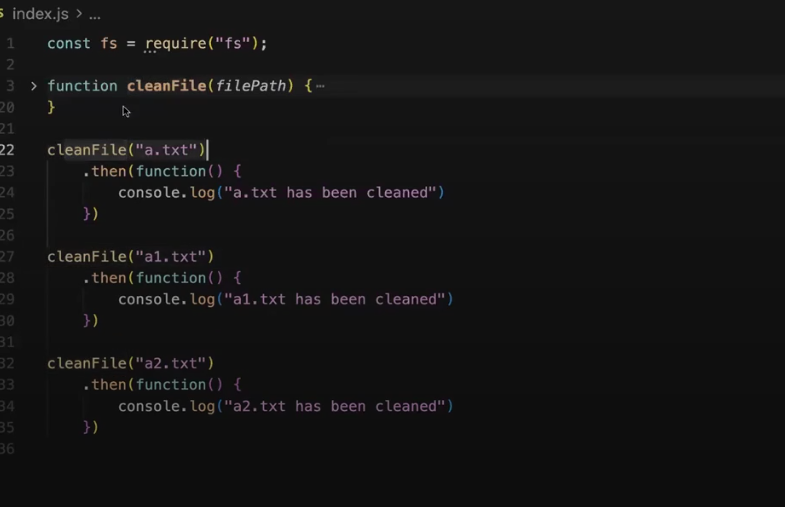
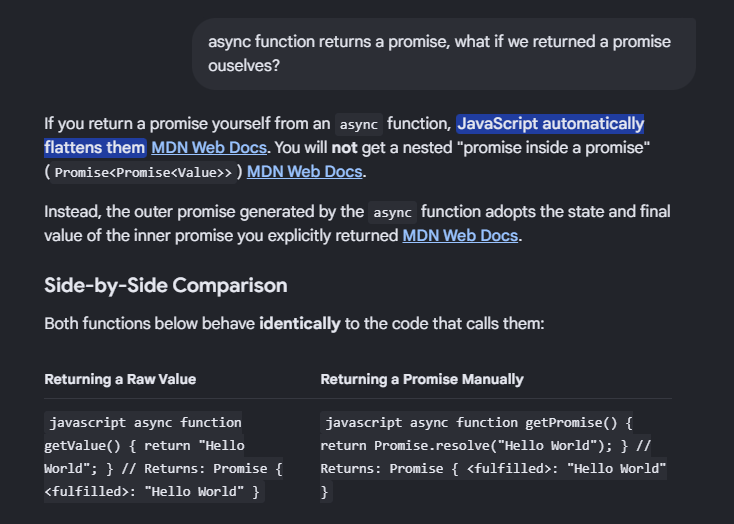

# Lecture 5: Writing promises and async await

**Date:** 2026-10-10
**Video:** [Writing Promise, Async Await](https://100xdevs.com/new-courses/21/video/4952)
**Notes:** [Notion](https://petal-estimate-4e9.notion.site/Week-5-3017dfd107358080a7addc8b02b0799f)

## What problem does this solve?
(1-2 lines)

## Key concepts
- Promises does not make sense in setInterval as its multiple calls, it will make sense if the call is once
- Why Promise -> we can use mordern syntax of resolve reject
- we cannot resolve the same promise multiple times, that was what we were doing in setInterval
- irrespective of what called then or catch, `.finally()` will be called later always afterwards
- on looking async syntax looks like synchronous code, but its not so, only the await thing inside async function is synchronous
- await pauses the execution of the async function until the promise settles
1. JavaScript starts executing main() immediately.

2. It executes synchronously until it encounters an await that needs to wait for a pending Promise.

3. At that point, main() suspends, and JavaScript continues executing the code after main().

4. When the awaited Promise fulfills, the suspended function resumes through Promise/microtask processing.
- We can only write await inside a async function
- Use `try{}` `catch(e){}` for error handling in async await
- always first write "how would i call this function" before writing the promise
- Writing Promise NOTE: if functions used are callback based async functions syntax a bit complex whereas if we need to make a promisified function on top of promisified function syntax is easy [5. File](5.%20cleanFile_extendedQuestion.js)
- The error in try catch may also come from a synchronous function also using `throw new Error()`
- An async function always returns a Promise, regardless of whether the functions inside it are promisified or not.

## Diagram / Screenshot
All three run parralelly, one that completes first logs first, random everytime

Doubt of async function returning a promise cleared!!


## Code I wrote
- [filename](filename)

## Commands / snippets to reuse
```bash
# command here
```

## Gotchas and mistakes
- 

## Still unclear
- return new error VS throw new error in async function

## Rebuilt from memory?
- [ ] Day 1
- [ ] After 1 week
