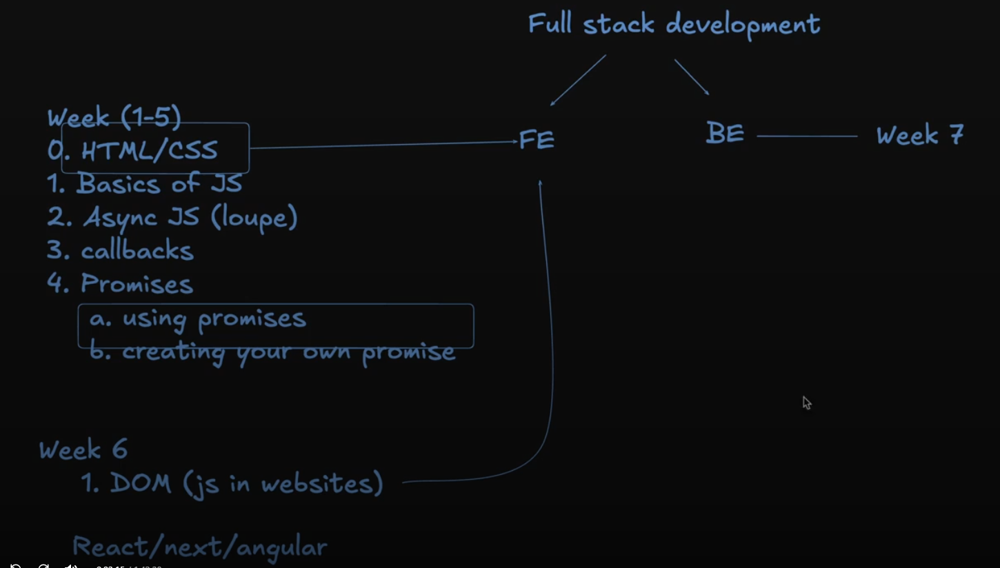
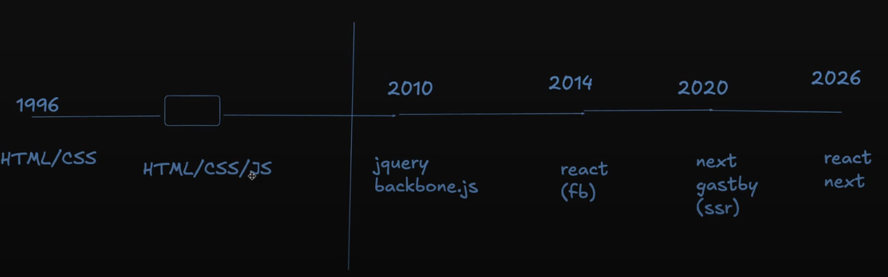
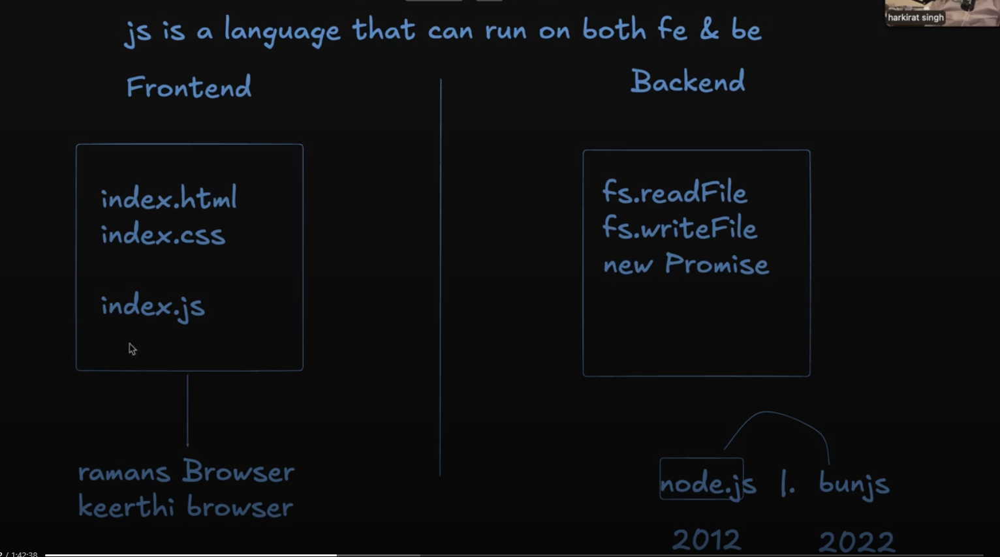
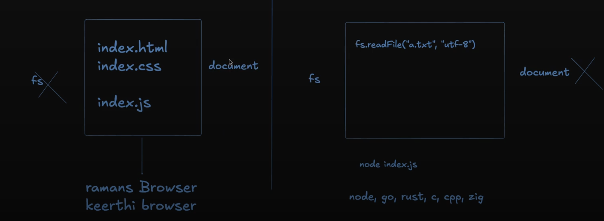

# Lecture 6: Starting Frontend ( DOM Basics )

**Date:** 2026-10-19
**Video:** [Starting Frontend ( DOM Basics )](https://100xdevs.com/new-courses/21/video/5273?from=%2Fnew-courses%2F21%2Fcontent%3FparentId%3D4154)
**Notes:** [Notion](https://petal-estimate-4e9.notion.site/DOM-Manipulation-d43659eddda44472913ecf90e4ebf218)

**Project:** *ToDoList*
## What problem does this solve?
(1-2 lines)

## Key concepts
- Only frontend, no backend, so on refresh everything back to basic
- js ia language that can run both on fe and be
- js was initaly meant to run on clients machine/browser for fe only, later node.js allowed us to run js on our own machine locally, helped for using js in be
- some things exists in fe js but not in be js and vice verse; eg> dom only in fe js, and fs package only in be js
- any dynamic changes only comes to the document object model in browser, it do not gets stored or saved, so on refresh the original state comes
- two step to write to dom: create + append
- in .innerHtml => could manually write the complete html with tags, using + sign to add variables => = "<>assdasd" + task "</>";
- `onclick` attribute in html = `addEventListener()` in js
```
// Method 1: Best Practice (Appends without overwriting)
element.classList.add("new-class");
element.classList.add("class-one", "class-two"); // Multiple 

// Method 2: Overwrite Everything
element.className = "new-class"; 

// Method 3: Safe Append with className (Requires leading space)
element.className += " new-class";
```

## Diagram / Screenshot
Till Now .....

History

js in fe vs be


## Code I wrote
- [filename](filename)

## Commands / snippets to reuse
```bash
# command here
```

## Gotchas and mistakes
- 

## Still unclear
- 

## Rebuilt from memory?
- [ ] Day 1
- [ ] After 1 week
