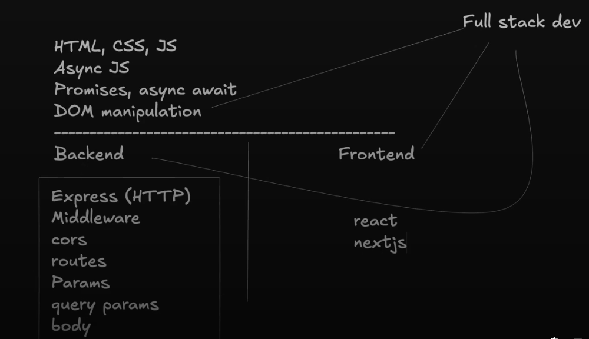
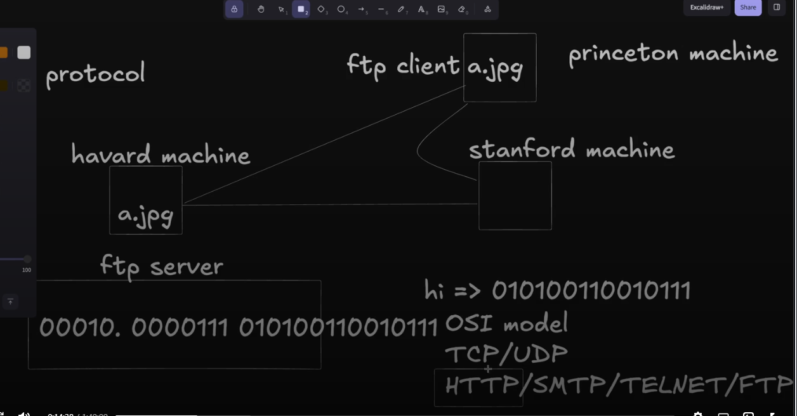
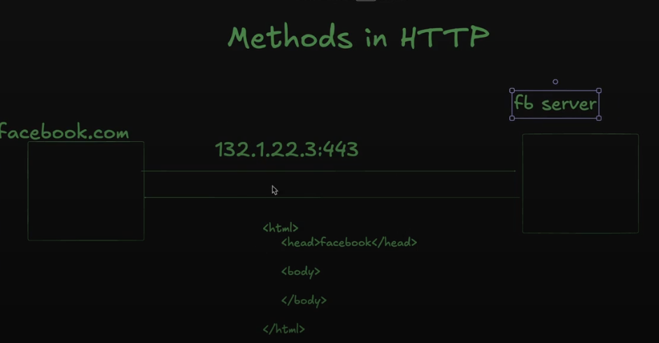
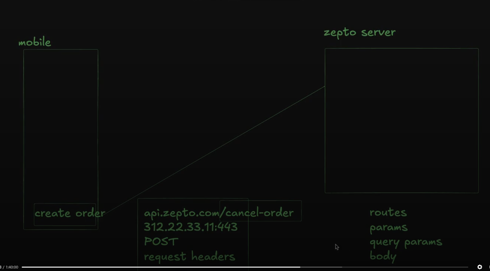
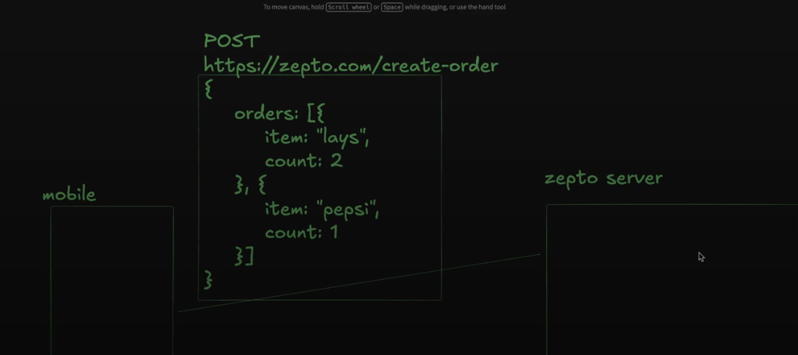
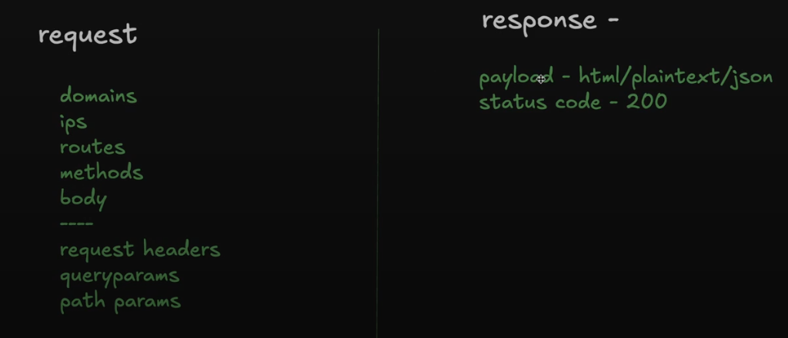

# Lecture 7: HTTP Part 1

**Date:** 2026-10-21
**Video:** [HTTP Part 1](https://100xdevs.com/new-courses/21/video/6390)
**Notes:** [Notion](https://projects.100xdevs.com/tracks/http-intro/Intro-to-HTTP-1)

## What problem does this solve?
(1-2 lines)

## Key concepts
- when i search/make a request of google.com, i get the HTML CSS (frontend) in return 
- server(machine(responder)) - client(machine(requester))
- protocols used by zoom - http, websockets, webrtc
- suppose we deploy our website on a server in russia, so now the client from india makes a request to the server in russia
- aws: service of providing servers for our websites
- for most of the cases http (request/response model) works, but their are cases where it might not work (eg. whatsaap, slack, zoom), here response only after request whereas in other protocols auto generate responses (eg. webRTC, websockets);
- when i start a server i get an ip address, but its hard to remember it so we give it a name i.e domain name, thru this client finds its server over the network (e.g. google.com);
- ipv4 -> ipv6
- domain name hit -> dns server -> points to corresponding ip
- two steps - first we deploy, second we map the domain name
1. creating a droplet (in digital ocean) to deploy code
2. going to goDaddy or squarespace and making the dns entry
- Ports: why to rent multiple servers for multiple processes, use the same server and assign them the individual tasks - multiple http servers in same machine/ip
- https - 443; http - 80 
- status code - 404: server resource not present (direction to the resource = route)
- you can get a 304: when you do a soft refresh (ctrl + R); but a hard refresh (ctrl + shift + R) could give a 200
- response -> payload (Response) = html/json/plaintxt; request -> payload (Payload) = body (route is not the right place to put the request body)
- backends = servers(backends run on servers (they are the machines)) (our aim is to create backends) The server is the container (the "where"), and the backend is the code running inside it (the "what").

## Diagram / Screenshot
**Content** 

Protocol?: Set of rules to be followed to share the data, making sure the format is same everywhere

An example of get request to fetch the data



Request Body : usually `JSON` (eg. chatGPT request of what is 2+2)

Things covered in this part

things left for next class

## Code I wrote
- [filename](filename)

## Commands / snippets to reuse
```bash
# command here
```

## Gotchas and mistakes
- 

## Still unclear
- pbf vs xml vs json; and which one do you prefer in a big application

## Rebuilt from memory?
- [ ] Day 1
- [ ] After 1 week
